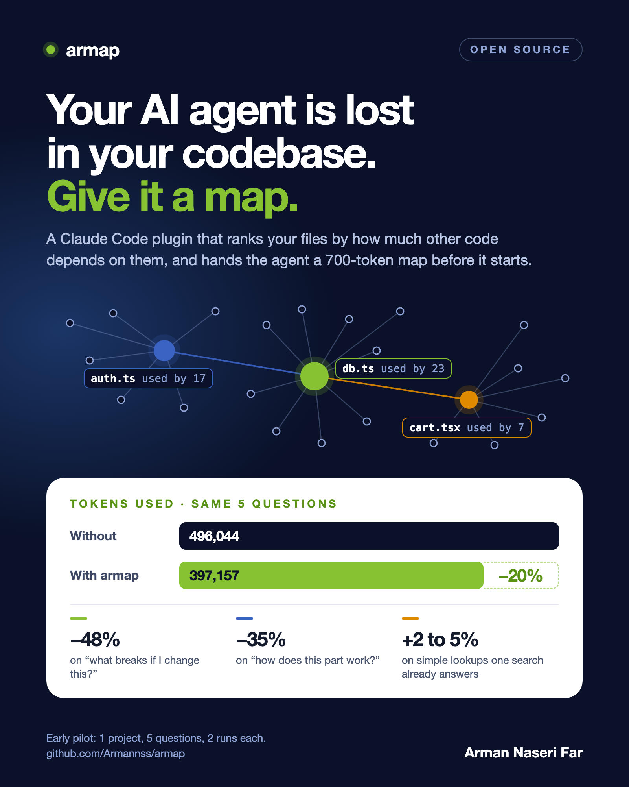

# armap



A Claude Code plugin that gives Claude a compact, ranked map of your codebase at the start of every session, so it opens the right files first instead of exploring blind.

- **Any language.** Definitions and references are found by pattern matching, with no compiler or language server. Around 50 file types are recognized, and imports are resolved to real files for 15 languages.
- **Zero dependencies.** Plain Node.js (18+). Nothing to install or build.
- **Token budgeted.** The map is capped (about 700 tokens by default) and lists the files other code depends on most, with the line number of each key definition.

## Install

```
/plugin marketplace add Armannss/armap
/plugin install armap@armap
```

## What Claude gets

At session start:

```
# Repo map: 108 source files (typescript 102, javascript 3, sql 3)
Top-level: app/ 61, lib/ 22, components/ 10

lib/prisma.ts (used by 27)
  L22 export const prisma =
lib/auth.ts (used by 16)
  L20 export async function hashPassword(password: string)
  L32 export async function getCurrentUserFromCookie(): Promise<SessionUser | null>
...
```

And two queries it can run on demand instead of grepping and reading whole files:

```
armap deps lib/auth.ts      # what this file uses, and what uses it
armap refs hashPassword     # where it is defined, and every file that references it
```

## Use it without Claude Code

```
node bin/armap.mjs map --root /path/to/repo --budget 2000
```

## How it works

1. List source files (respecting `.gitignore`).
2. Extract definitions with keyword patterns shared across languages, and collect the identifiers each file mentions.
3. Resolve import statements to files in the repository (relative paths, path aliases, packages, includes).
4. Link each file to the files whose symbols it imports and uses, then rank files with PageRank.
5. Print the highest-ranked files and their most-referenced symbols until the token budget is reached.

## Limitations

- Imports are resolved for JavaScript, TypeScript, Python, Go, Rust, Java, Kotlin, Scala, C, C++, C#, Ruby, PHP, Dart and Elixir. Other languages fall back to matching names, which can produce false links for common words.
- Parsing is by pattern, not by compiler. Imports built from variables, reflection and dependency injection are not seen.
- Class methods are not listed for every language.

## Benchmarks

A small pilot, not a full benchmark, measured on version 0.1 before import resolution was added: one private Next.js project (108 source files), five questions, two runs each, Claude Sonnet, with read-only tools in both conditions. Tokens are the total processed across all turns.

| question type | without armap | with armap | change |
|---|---:|---:|---:|
| Who calls this function? | 69,214 | 72,482 | +5% |
| Where is this symbol defined and used? | 67,921 | 70,989 | +5% |
| Which routes have feature X? | 106,316 | 108,269 | +2% |
| What is affected if I rename this? | 137,655 | 71,190 | -48% |
| How does this subsystem work? | 114,940 | 74,229 | -35% |
| **total** | 496,044 | 397,157 | **-20%** |

Answers were correct in every run in both conditions. The saving comes from fewer round trips on multi-step questions. On lookups that a single search already answers, the map is a small overhead.

Run it on your own repository with `node benchmark/run.mjs --repo <dir> --questions <file.json>`. Each run uses your Claude usage.

## License

MIT
